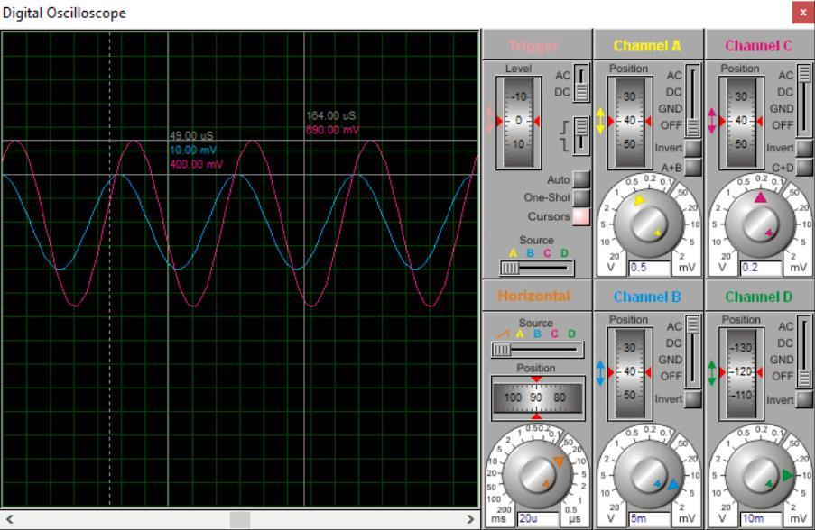
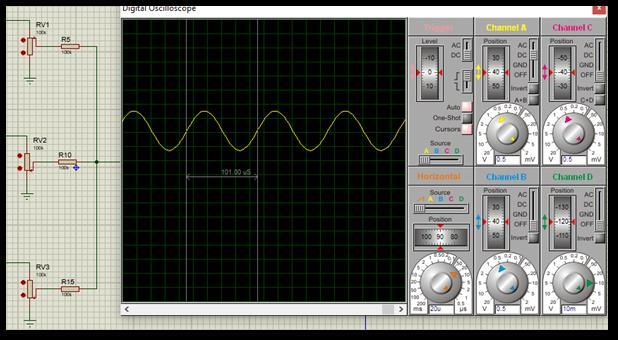
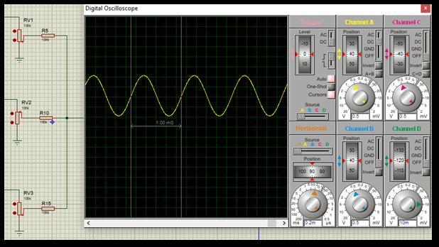
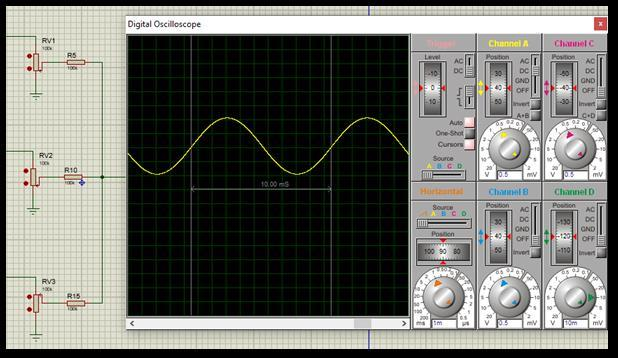
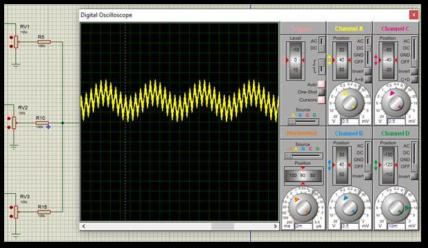
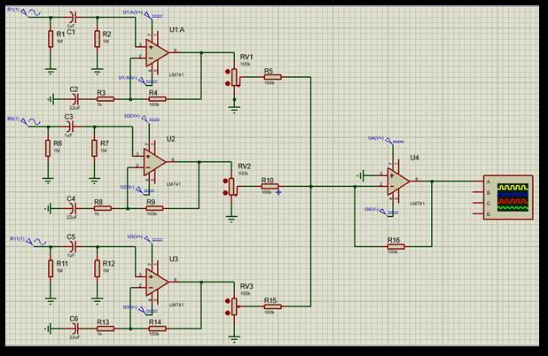
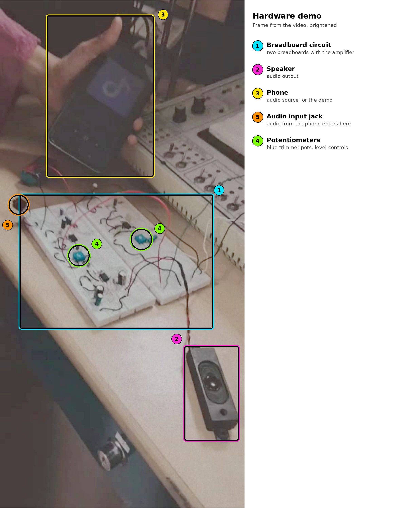

# 3-Input Microphone Pre-Amplifier and Mixer

**Electronic Circuits and Devices (ECD) Final Lab Project (EE-19B) · Institute of Space Technology, Islamabad**

A three-channel audio pre-amplifier and mixer built from op-amps. Each microphone input has its own AC-coupled amplifier stage with a gain of about 100, a potentiometer sets each channel's level, and an inverting summing amplifier combines the three channels into one output. The design was first built and analysed in **Proteus**, then implemented on **breadboards** and demonstrated with a speaker.

---

## Results (Proteus simulation)

The three inputs were set to 10 mV at different frequencies, so each channel could be told apart in the mixed output.

| Mic In 1 | Mic In 2 | Mic In 3 | Output | Output frequency | Phase |
|---|---|---|---|---|---|
| 100 % (10 kHz) | 0 % | 0 % | about 1 V peak | 10 kHz | 180° |
| 0 % | 100 % (1 kHz) | 0 % | about 1 V peak | 1 kHz | 180° |
| 0 % | 0 % | 100 % (100 Hz) | about 1 V peak | 100 Hz | 180° |
| 50 % | 50 % | 50 % | combined waveform of all three | | |

**Gain check.** The theoretical gain of each stage is `1 + R_f / R_i = 1 + 100 kΩ / 1 kΩ = 101`. At 10 kHz the simulation showed 10 mV in and 0.9 V out, a gain of about 90. This shortfall is consistent with the limited gain-bandwidth of the LM741 op-amp, whose open-loop gain falls at higher frequencies.

| Gain check (10 mV in, 0.9 V out) | Input 1 alone (10 kHz) |
|---|---|
|  |  |

| Input 2 alone (1 kHz) | Input 3 alone (100 Hz) |
|---|---|
|  |  |

**All inputs at 50 %.** The mixed output contains all three signals: the fast 10 kHz component rides on the slower 1 kHz and 100 Hz waves.



---

## Circuit



**Input stages (three identical channels).** Each channel is a non-inverting amplifier built around an LM741:

- A 1 µF **coupling capacitor** blocks any DC from the microphone, and two 1 MΩ resistors set the DC bias point of the input.
- The 100 kΩ feedback resistor and a 1 kΩ resistor in series with a 22 µF capacitor set the gain to `1 + 100 kΩ / 1 kΩ = 101` for audio signals. For DC the capacitor is an open circuit, so the stage has unity DC gain and does not amplify its own offset.

**Level controls.** A 100 kΩ potentiometer on each channel, followed by a 100 kΩ resistor, lets the level of each microphone be adjusted from zero to maximum before mixing.

**Mixer.** The final op-amp is an **inverting summing amplifier** with a 100 kΩ feedback resistor. It adds the three channels together, and because it is inverting, the output is shifted by 180° compared with the input. This matches the phase column in the results table.

---

## Circuit concepts demonstrated

| Concept | Where it appears |
|---|---|
| Non-inverting amplifier gain | Each input stage, `1 + R_f / R_i = 101` |
| AC coupling and DC biasing | 1 µF coupling capacitor and 1 MΩ bias resistors at each input |
| Frequency-dependent gain | A capacitor in the feedback network gives high AC gain and unity DC gain |
| Op-amp bandwidth limits | Measured gain of about 90 against 101 at 10 kHz, consistent with the LM741's gain-bandwidth |
| Potentiometer level control | Adjustable attenuation before the mixer |
| Inverting summing amplifier | Mixes three channels and inverts the phase by 180° |
| Signal analysis | Separating the three channels by frequency (10 kHz, 1 kHz, 100 Hz) on an oscilloscope |
| Simulation to hardware workflow | Designed and verified in Proteus before building on breadboards |

---

## Hardware implementation

After simulation, the circuit was built on breadboards using an LM348 (a quad LM741 package). In the demonstration, audio from a phone was fed into the circuit's input jack, and the amplified output was played through a speaker.



*Frame from the hardware demonstration video, brightened and annotated.*

---

## Components

| Component | Details |
|---|---|
| Op-amps | LM741 in the simulation; LM348 (quad LM741) in the hardware |
| Input coupling capacitors | 1 µF, one per channel |
| Bias resistors | 1 MΩ, two per channel |
| Gain-setting network | 100 kΩ feedback resistor, 1 kΩ resistor and 22 µF capacitor per channel |
| Level controls | 100 kΩ potentiometers, one per channel, each with a 100 kΩ series resistor |
| Mixer | LM741 inverting summing stage with a 100 kΩ feedback resistor |
| Test equipment | Oscilloscope, power supply, speaker |

---

## Design notes and possible improvements

- **Bandwidth.** The LM741 is an older general-purpose op-amp, and its limited gain-bandwidth reduces the gain at 10 kHz.
- **Noise.** The LM741 is not a low-noise audio op-amp, which matters for microphone signals.
- **Polarity.** The summing stage inverts the signal. A second inverting stage would restore the original polarity.
- **Possible upgrades.** Use a low-noise audio op-amp such as the NE5532 or TL072, add a low-pass filter before the output, or add a power amplifier stage to drive the speaker more strongly.

---

## Repository contents

```
microphone-preamplifier/
├── README.md
├── Technical Report.pdf
└── images/
    ├── proteus_schematic.jpg
    ├── scope_gain_check.jpg
    ├── scope_input1_10kHz.jpg
    ├── scope_input2_1kHz.jpg
    ├── scope_input3_100Hz.jpg
    ├── scope_mixed_output.jpg
    └── hardware_overview_annotated.png
```
